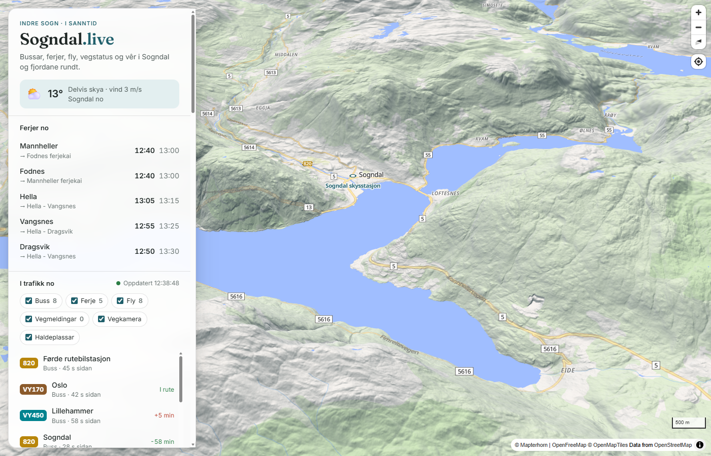
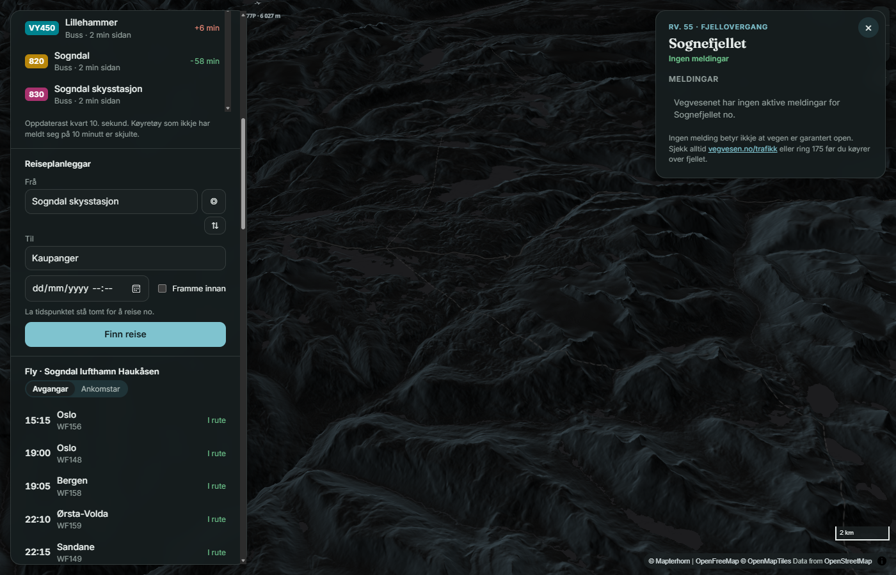

# Sogndal.live

**Sogn i sanntid på et 3D-kart.** Busser, ferjer og fly som beveger seg mens du ser på,
avganger, reiseplanlegger, status for fjellovergangene, veikameraer og vær – for Sogndal og
fjordene rundt.



<details>
<summary>Mørkt tema</summary>



</details>

## Funksjoner

- **Busser og ferjer i sanntid** fra Entur, oppdatert hvert 10. sekund. Utzoomet er de ikoner
  som peker i kjøreretningen; på nært hold (zoom 14.5+) blir de 3D-modeller. Klikk for rute og
  videre stopp.
- **Fly** i lufta rundt Haukåsen (ADS-B) og flytavle for Sogndal lufthavn. Fly til og fra
  Sogndal blir merket og koblet til flytavla.
- **Ferjer nå** – neste avganger fra Mannheller, Fodnes, Hella, Vangsnes og Dragsvik.
- **Avgangstavler** for alle holdeplasser, med søk.
- **Reiseplanlegger** fra stopp, adresse eller din posisjon. Ruta tegnes på kartet.
- **Fjelloverganger** – Sognefjellet, Gaularfjellet, Vikafjellet, Aurlandsfjellet,
  Hemsedalsfjellet og Filefjell – basert på meldingene fra Statens vegvesen.
- **Veimeldinger og veikameraer** på kartet.
- **Været nå** fra MET Norge.
- **Lyst, mørkt eller automatisk tema** (mørkt fra solnedgang til soloppgang).
- **Lettvektsmodus** uten 3D-terreng for eldre mobiler – slås på automatisk.
- **Kan installeres som app (PWA)** og er universelt utformet (tastatur og skjermleser).
- **Ingen informasjonskapsler og ingen sporing.** Skrift og kartbibliotek ligger på egen server.

## Kom i gang

Krever [Docker](https://www.docker.com/).

```bash
git clone https://github.com/brasande/sogndal.live.git
cd sogndal.live
docker compose up -d --build
```

Åpne <http://localhost:8090>.

Etter endringer i koden: kjør `docker compose up -d --build` på nytt. Filene kopieres inn i
imaget når det bygges.

> Siden trenger nginx-proxyene i `nginx.conf` for fly, vær og veimeldinger. Åpner du
> `public/index.html` direkte eller med en enkel filserver, fungerer busser, ferjer,
> avganger og reiseplanlegger, men ikke de tre.

## Innstillinger

Alt som er ment å endres ligger i [`public/config.js`](public/config.js):

| Innstilling | Standard | Forklaring |
| --- | --- | --- |
| `enturClientName` | `sogndallive-kart` | Identifiserer appen overfor Entur. Entur krever formatet `selskap-applikasjon`. Bytt til ditt eget. |
| `goatcounter` | tom (av) | Kodenavn fra [GoatCounter](https://www.goatcounter.com) for informasjonskapselfri besøksstatistikk. |

## Slik henger det sammen

Siden er ren HTML, CSS og JavaScript uten byggesteg eller rammeverk. Kartet er
[MapLibre GL JS](https://maplibre.org/). Det meste av data hentes direkte fra nettleseren;
tre kilder går via nginx:

```text
Nettleser ──► Entur (sanntid, avganger, reiser, stedssøk)
          ──► OpenFreeMap og Mapterhorn (kart og terreng)
          ──► Statens vegvesen (kamerabilder)
          ──► nginx ─┬─ /adsb/ ──► adsb.lol         mangler CORS · cache 5 s
                     ├─ /met/  ──► api.met.no       MET krever User-Agent · cache 10 min
                     └─ /ad/   ──► Allemannsdata    se under · cache 2 min
```

Veimeldings-API-et hos Allemannsdata svarer tomt når forespørselen har en `Origin`-header,
slik alle kall fra nettlesere har. Derfor går det via serveren.

### Filer

| Fil | Innhold |
| --- | --- |
| `public/index.html` | Siden |
| `public/style.css` | Stilark, lyst og mørkt tema |
| `public/js/core.js` | Kart, tema, lettvektsmodus, detaljkort og felles hjelpefunksjoner (`window.SL`) |
| `public/js/vehicles.js` | Busser og ferjer, ikoner og 3D-modeller |
| `public/js/planes.js` | Fly i lufta og flytavle |
| `public/js/stops.js` | Holdeplasser, avganger, stoppsøk, ferjer nå, turmål |
| `public/js/roads.js` | Veimeldinger, fjelloverganger, veikameraer |
| `public/js/trip.js` | Reiseplanlegger |
| `public/js/extras.js` | Vær, statistikk, service worker |
| `public/sw.js` | Service worker: nett først, cache som reserve. Sanntidsdata caches aldri. |
| `public/vendor/` | MapLibre GL JS 5.24.0 og skrifttypene Inter og Fraunces |
| `nginx.conf` | Proxyer, cache, komprimering og sikkerhetsheadere (CSP m.fl.) |

Modulene deler kart og hjelpefunksjoner gjennom `window.SL`. Kartlag registreres med
`SL.onStyle(fn)`, slik at de lages på nytt når temaet bytter kartstil. I nettleserkonsollen
er det samme objektet tilgjengelig som `sogndalKart`.

### Vanlige endringer

- **Flere veikameraer:** legg til i `WEBCAMS` i `public/js/roads.js`. Kamera-ID finner du på
  [vegvesen.no/trafikk](https://www.vegvesen.no/trafikk); bildet ligger på
  `https://kamera.atlas.vegvesen.no/api/images/<id>_1`.
- **Flere faste holdeplasser:** legg til i `STOPS` i `public/js/stops.js` med NSR-ID fra Entur.
- **Nye turmål:** `PLACES` i samme fil.
- **Flere fjelloverganger:** `PASSES` i `public/js/roads.js` (veinummer, midtpunkt og radius).
- **Endrede filer i skallet:** øk `CACHE`-versjonen i `public/sw.js`, så gamle filer ryddes bort.

## Publisering

**Docker (anbefalt).** Imaget er en vanlig nginx-container og kan kjøre hvor som helst,
for eksempel Azure Container Apps, Fly.io eller en egen server. Kjør bak HTTPS – det kreves for
PWA og posisjon.

**Netlify.** `public/` kan publiseres direkte; `_redirects` og `_headers` gir de samme proxyene
og headerne. Netlify kan ikke fjerne `Origin`-headeren, så veimeldingene og fjellstatusen kan
bli tomme der.

## Kjente begrensninger

- **Fjellstatus** bygger bare på meldingene fra Vegvesenet. Ingen melding betyr ikke at
  veien er garantert åpen – siden sier det samme, og viser til vegvesen.no og 175.
- **Koordinatene til veikameraene** er omtrentlige, satt ut fra stedsnavnet på bildet.
- **Bussposisjoner** kommer fra operatøren via Entur. Enkelte busser melder seg sjelden eller
  blir stående med gammel posisjon; de dimmes etter 2 minutter og skjules etter 10.
- **Flyposisjoner** kommer fra frivillige ADS-B-mottakere og kan mangle i fjellterreng.

## Kilder og lisenser

| Data | Kilde | Lisens |
| --- | --- | --- |
| Sanntid, avganger, reiser, stedssøk | [Entur](https://developer.entur.org/) | NLOD |
| Kart | [OpenFreeMap](https://openfreemap.org/), [OpenStreetMap](https://www.openstreetmap.org/copyright) | ODbL |
| Terreng | [Mapterhorn](https://mapterhorn.com/attribution) | se kilden |
| Vær | [MET Norge](https://api.met.no/) | CC BY 4.0 |
| Flytavle | Avinor via [Allemannsdata](https://allemannsdata.com/) | se kilden |
| Fly i lufta | [adsb.lol](https://adsb.lol/) | ODbL |
| Veimeldinger og kameraer | [Statens vegvesen](https://www.vegvesen.no/trafikk/) | NLOD |

Medfølgende programvare: MapLibre GL JS (BSD-3-Clause), Inter og Fraunces (SIL Open Font
License). Lisensfilene ligger i `public/vendor/`.

## Lisens

Koden er lisensiert under [MIT](LICENSE). Data og tredjepartsprogramvare har egne lisenser,
se tabellen over.

## Bidra

Feilrapporter og forslag er velkomne som issues. For pull requests: følg samme stil som
koden rundt (nynorsk i grensesnitt og kommentarer, ingen byggesteg), og test i både lyst og
mørkt tema og på mobil.

---

### English

Sogndal.live is a real-time 3D map of Sogndal and inner Sogn, Norway: live buses, ferries and
aircraft, departures, a journey planner, mountain pass status, road cameras and weather.
Plain HTML/CSS/JS with MapLibre GL JS, served by nginx with three small proxies.
Run it with `docker compose up -d --build` and open <http://localhost:8090>.
The interface is in Norwegian (Nynorsk).
